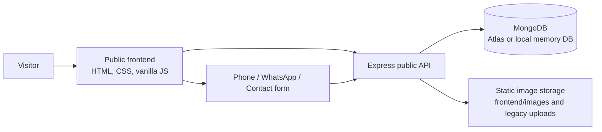

# EcoLith Energy Architecture

## System overview

EcoLith Energy is a public marketing and product-information website backed by a small Node.js/Express API. Customers can browse products, factory/gallery photos, reviews, and contact details, and can submit an inquiry without creating an account.

Customer login/signup, Google OAuth, customer profiles, cart/wishlist, dealer applications, staff login, admin dashboard, admin APIs, and upload management have been removed. No authentication/session mechanism is configured in the running application. Previously stored account/admin records in MongoDB are not deleted by this code change.

## Frontend architecture

The public frontend uses HTML5, CSS3, and vanilla JavaScript:

- `frontend/index.html` – public homepage and all main marketing sections
- `frontend/style.css` – brand tokens, layout, responsive behavior, and components
- `frontend/script.js` – mobile navigation, public API loading, product modal, contact form, and page interactions
- `frontend/images/` – preserved EcoLith factory and product imagery

The frontend is served by Express in local/backend deployments and is the Vercel static output directory in static deployments. Previous customer and admin interface files were removed.

## Backend architecture

- `backend/src/server.js` – database connection, public-site data seeding, and server lifecycle
- `backend/src/app.js` – Express middleware, public API routes, static files, SEO endpoints, and error handling
- `backend/src/config/` – environment, database, and HTTP security-header configuration
- `backend/src/controllers/` – product, review, inquiry, gallery, and settings behavior
- `backend/src/models/` – Mongoose models for public content and inquiries
- `backend/src/routes/` – public resource routes
- `backend/src/validators/` – request validation schemas
- `backend/src/middleware/` – API/inquiry rate limiting, request validation, audit logging, and error handling
- `backend/src/services/` – remaining public-site support services
- `backend/src/utils/` – logging, response formatting, and input sanitization
- `backend/uploads/` – runtime-served legacy media files; upload management is disabled

## Public REST API

Routes are mounted under `/api`:

- `GET /api/products` and `GET /api/products/:slug` – published catalog
- `GET /api/reviews` – published reviews
- `POST /api/inquiries` – validated, rate-limited public inquiry submission
- `/api/gallery` – public facility/gallery content
- `/api/settings/public` – public contact and branding settings

Account, authentication, order, admin, and upload-management routes are not mounted. Requests to those endpoints return 404. They must not be re-enabled without a separately approved authentication/access-control design.

## Persistence

MongoDB is accessed with Mongoose. Production can use MongoDB Atlas; local development can use the configured in-memory MongoDB fallback.

Current model files:

- `Product` – LFP/NMC product content, publication and SEO fields
- `Inquiry` – contact submissions and lead status
- `Review` – public review content
- `Gallery` – published facility/product imagery
- `SiteSettings` – public company/contact presentation
- `AuditLog` – event history used by existing controller helpers

Product records are addressed by a unique slug. Product category, publication, featured state, and ordering fields support public catalog queries. Inquiry records are indexed for phone, status, and creation date. Existing MongoDB collections from the removed account/admin system are left untouched and are no longer used by this application.

## Admin and customer functionality status

There is no admin panel or staff-management API in the deployed application. Content changes that previously used the admin dashboard require direct approved database/content maintenance until a new protected management workflow is intentionally designed.

There are no customer accounts, login/signup pages, Google OAuth, email verification, password reset, profiles, cart, wishlist, dealer applications, or checkout. Public product inquiries remain available through the contact form and direct WhatsApp/phone links.

## Image handling

Original factory and product images are stored in `frontend/images/` and served at `/images`. Existing files under `backend/uploads/` remain served at `/uploads` for compatibility with previously stored product image URLs. No image-upload API or admin upload interface remains active.

Do not replace real EcoLith factory photographs, product images, logos, or battery labels with invented assets.

## Security, errors, and logging

- Helmet-derived security headers are configured through `backend/src/config/securityHeaders.js`.
- CORS accepts the configured frontend origins and known EcoLith origins.
- API requests are rate-limited; inquiry submissions have an additional limiter.
- Request data is sanitized and request bodies are validated with the existing validators.
- Errors flow through centralized not-found and error handlers.
- Development HTTP requests are logged with Morgan; application events use the shared logger.
- There are no application sessions, login credentials, OAuth callbacks, or privileged routes.

## Deployment and environment

Vercel uses `frontend/` as the static output directory and rewrites unknown public paths to `index.html`. The Express deployment serves the same frontend and public API.

Environment variables are listed in `.env.example`:

- `NODE_ENV`, `PORT`
- `MONGODB_URI`, `USE_MEMORY_DB_FALLBACK`
- `CLIENT_URL`, `FRONTEND_URL`, `API_URL`
- Optional `IP_HASH_SALT` for inquiry IP pseudonymization

Session secrets, Google OAuth credentials, SMTP credentials, and admin bootstrap credentials are no longer required. Keep any old local `.env` values private; this change does not read or expose them.

## Architecture diagram

## Maintenance guidance

Update this document if the public API, MongoDB models, asset storage, or deployment topology changes. Do not reintroduce customer/staff authentication or admin routes without an explicit product decision and a server-enforced access-control design.
