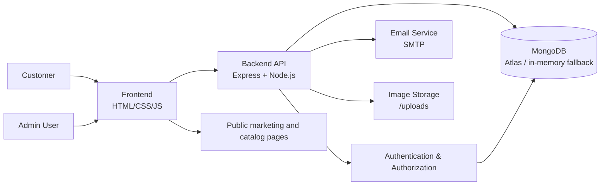

# EcoLith Energy Architecture

## 1. System overview

This project is a full-stack web application for EcoLith Energy, a Delhi-based lithium battery manufacturing business. The application combines a public marketing website, customer authentication flows, product discovery, dealer registration, inquiry handling, gallery management, and an administrative control panel for staff.

The live system is structured around:

- Frontend: static HTML, CSS and vanilla JavaScript served from `frontend/`
- Backend: Node.js and Express API in `backend/src/`
- Persistence: MongoDB with Mongoose ODM, plus an in-memory MongoDB fallback for local development
- Security: session-based authentication, role-based access control, CSRF protection, rate limiting, sanitization, and upload validation
- Operational services: SMTP email delivery, Google OAuth, file upload storage, and admin audit logging

The application is designed to support both public-facing customer journeys and internal admin operations without introducing a larger frontend framework.

## 2. Frontend architecture

The frontend is intentionally lightweight and built with HTML5, CSS3, and vanilla JavaScript.

### Public site
- `frontend/index.html` serves the homepage and core marketing pages.
- `frontend/style.css` contains the brand styling, layout system, color tokens, buttons, product sections, and responsive rules.
- `frontend/script.js` handles interactions such as navbar behavior, animations, FAQ or contact form flows, and calls to API endpoints when needed.
- `frontend/images/` contains preserved company photography and product imagery.

### Customer-facing authenticated pages
- `frontend/client/login.html` and `frontend/client/signup.html`
- `frontend/client/dashboard.html`
- `frontend/client/profile.html`
- `frontend/client/forgot-password.html`
- `frontend/client/reset-password.html`

Customer pages share styling and logic through `frontend/client/customer-auth.css`, `frontend/client/customer-auth.js`, and `frontend/client/script.js`.

### Admin panel
- `frontend/admin/index.html` is the admin entry page.
- `frontend/admin/admin.css` styles the staff dashboard.
- `frontend/admin/admin.js` handles admin UI behavior and API calls.

The backend serves these static assets at:
- `/` for the public site
- `/login`, `/signup`, `/dashboard`, `/profile`, `/forgot-password`, `/reset-password/:token` for customer flows
- `/admin` and `/admin/*` for staff views

## 3. Backend architecture

The backend entry points are:
- `backend/src/server.js` – starts the app and connects the database
- `backend/src/app.js` – configures Express middleware, CORS, sessions, rate limiting, static exports, and route registration

### Main backend modules
- `backend/src/config/` – environment config, database config, passport setup, and security headers
- `backend/src/middleware/` – auth, RBAC, CSRF, upload validation, validation helpers, and rate limiting
- `backend/src/routes/` – API route registration for auth, products, reviews, inquiries, gallery, uploads, settings, orders, and admin work
- `backend/src/controllers/` – business logic for each domain
- `backend/src/models/` – MongoDB schemas and relationships
- `backend/src/validators/` – Zod-based request validation
- `backend/src/services/` – email, upload, and WhatsApp helper integrations
- `backend/src/utils/` – logging, response formatting, and sanitization
- `backend/src/scripts/` – bootstrap and security validation utilities

## 4. Database architecture

The application uses MongoDB via Mongoose. Production expectations are centered on MongoDB Atlas, while local development will fall back to an in-memory MongoDB instance if a configured database is unavailable.

### Primary models
- `User` – customer and dealer account data, auth state, cart, wishlist, addresses, verification tokens and account lockouts
- `Admin` – staff accounts with role-based access (`SUPER_ADMIN`, `ADMIN`, `EDITOR`)
- `Product` – published battery product catalog data and SEO metadata
- `Inquiry` – website lead capture and requirement submissions
- `Review` – public customer feedback and Google review records
- `Gallery` – facility and battery image entries for the public site
- `SiteSettings` – global brand and contact settings
- `Order` – order creation and purchase workflow metadata
- `AuditLog` – admin actions and security review tracking

### Relationship notes
- `User` stores `cart` entries with embedded `productId` references and `quantity`.
- `User` stores `wishlist` as references to product documents.
- `Product` documents are indexed by `slug`, `category`, `isFeatured`, `isPublished`, and `sortOrder`.
- `Inquiry` documents are indexed by phone and created timestamp for lead management.
- `Admin` and `User` both enforce unique email values and support lockout tracking.
- `AuditLog` is structured for admin action history reporting.

## 5. REST API structure

The API is organized primarily around resource modules and is mounted under `/api`.

### Customer auth and profile
- `/api/auth/signup`
- `/api/auth/login`
- `/api/auth/google/signup`
- `/api/auth/google/login`
- `/api/auth/google/callback`
- `/api/auth/forgot-password`
- `/api/auth/reset-password`
- `/api/auth/verify-email`
- `/api/auth/logout`
- `/api/auth/me`
- `/api/auth/wishlist`
- `/api/auth/cart`
- `/api/auth/apply-dealer`

### Public product and review APIs
- `/api/products`
- `/api/products/:slug`
- `/api/reviews`

### Inquiry and contact APIs
- `/api/inquiries`
- `/api/inquiries/:id` (internal admin access)

### Admin APIs
- `/api/admin/auth/login`
- `/api/admin/dashboard`
- `/api/admin/products`
- `/api/admin/reviews`
- `/api/admin/gallery`
- `/api/admin/inquiries`
- `/api/admin/settings`
- `/api/admin/users`
- `/api/admin/audit-logs`

### Upload APIs
- `/api/admin/upload` for upload security, validation, and file storage
- `/uploads` serves uploaded media files at runtime

## 6. Admin panel architecture

The admin panel is authored as a server-rendered static front end with API-driven actions. Access is protected by server-side auth and role middleware.

### Role model
- `SUPER_ADMIN` – full access to staff user management, product and settings management, and audit logs
- `ADMIN` – operational access for products, gallery, inquiries, reviews, and site settings
- `EDITOR` – limited content-editing access for products and gallery content

### Admin capabilities
- Product creation, update, publish toggling, and deletion
- Review moderation and publication controls
- Inquiry status changes and CSV export
- Gallery asset management and uploads
- Global site settings management
- Staff user management (super-admin only)
- Audit log review

## 7. Customer authentication architecture

Customer accounts are stored in the `User` model and use MongoDB-backed sessions from `express-session` with `connect-mongo`.

Key behaviors:
- Passwords are hashed with `bcryptjs` (12 salt rounds)
- Account lockouts are stored via `failedLoginAttempts` and `lockedUntil`
- Email verification is supported through a verification token workflow
- Password reset is supported through secure reset tokens and expiry timestamps
- Role-based status is stored on the user (`CUSTOMER`, `DEALER`, `DISTRIBUTOR`)
- Session cookies are configured with `HttpOnly`, `SameSite=Lax`, and `Secure` in production

## 8. Google OAuth integration

Google OAuth is configured through Passport.js and the Google OAuth 2.0 strategy.

### Flow
- `/api/auth/google/signup` begins signup intent
- `/api/auth/google/login` begins login intent
- `/api/auth/google/callback` completes the OAuth exchange
- `passport.js` verifies the email is present and `email_verified` is true
- Accounts are created or linked based on the selected intent and existing user state
- The callback redirects customers back to the frontend dashboard or login pages

### Security checks
- Existing email collisions are rejected during signup
- Inactive or locked accounts are refused
- Google login only continues for matched account records
- Unverified Google emails are blocked

## 9. Email verification and password recovery

The backend includes email-driven account workflows implemented through a Nodemailer-backed service.

This includes:
- customer email verification on signup
- password reset requests via tokenized email links
- account recovery flows tied to the user record
- SMTP configuration via environment variables for host, port, secure flag, credentials, and sender address

## 10. Image upload and storage architecture

Uploads are stored in the runtime directory `backend/uploads/` and are served via `/uploads`.

### Upload protections
- File type validation is performed before saving
- Magic-byte validation is used to reject malformed images
- Size limits are enforced
- Only accepted image extensions are allowed

### Usage cases
- Product image uploads
- Product gallery media
- Facility photography and admin-managed gallery items

## 11. Dealer application workflow

Customer users can apply to become a dealer or distributor through the customer auth API:
- `/api/auth/apply-dealer`

The `User` model stores dealer-specific fields:
- `shopName`
- `gstNumber`
- `dealerAddress`
- `dealerStatus` (`PENDING`, `APPROVED`, `REJECTED`)

This workflow is designed to support a formal approval process without exposing private admin-only controls to the public site.

## 12. Product enquiry and cart workflow

### Enquiries
Website contact leads are stored in the `Inquiry` model with fields such as:
- name
- phone
- email
- company
- requirement
- message
- status
- source
- ipHash

This supports lead tracking and CRM-like status management.

### Cart and wishlist
Customer users can manage:
- wishlist items
- cart quantities
- saved addresses

These are stored directly on the `User` document as embedded arrays and references.

## 13. Session management and security architecture

Security is enforced with multiple layers:

- `express-session` plus `connect-mongo` for server-side session storage
- `helmet` for security headers
- CORS allowlisting for known frontend origins
- CSRF middleware using a double-submit token pattern
- API rate limiting and login throttling
- Request sanitization against object injection and XSS vectors
- NoSQL sanitization logic on request bodies, params, and query data
- Admin and customer auth checks before protected routes

## 14. Deployment architecture

The project is intended to run as a single Node.js service fronted by the backend application, while the frontend assets are served directly by Express.

### Current deployment model
- The backend is deployed as a Node.js service on a backend domain
- The frontend is served from the public domain origin
- `COOKIE` credentials and CORS are configured against exact origins, especially the frontend and API URLs
- `robots.txt` and `sitemap.xml` are served from the backend to support SEO and crawling

### Runtime directories
- `backend/uploads` stores uploaded files
- `frontend/images` holds preserved public gallery and factory images
- project-level `.env` holds private runtime configuration

## 15. Environment variable requirements

The application expects the following environment variables from the project root `.env`:

- `NODE_ENV`
- `PORT`
- `MONGODB_URI`
- `USE_MEMORY_DB_FALLBACK`
- `SESSION_SECRET`
- `SESSION_NAME`
- `SESSION_MAX_AGE_MS`
- `CLIENT_URL`
- `FRONTEND_URL`
- `API_URL`
- `GOOGLE_CLIENT_ID`
- `GOOGLE_CLIENT_SECRET`
- `DEFAULT_ADMIN_NAME`
- `DEFAULT_ADMIN_EMAIL`
- `DEFAULT_ADMIN_PASSWORD`
- `SMTP_HOST`
- `SMTP_PORT`
- `SMTP_SECURE`
- `SMTP_USER`
- `SMTP_PASSWORD`
- `SMTP_FROM`

These values are defined in `.env.example` and should remain out of version control in the actual `.env` file.

## 16. Error handling and logging

The backend uses dedicated utilities for:
- central error responses
- request logger output in development mode
- audit logging for admin actions
- consistent API response shapes
- 404 handling for missing routes

The core processing flow is:
- request validation
- route-specific auth checks
- controller logic
- model persistence
- response formatting
- error middleware propagation

## 17. Mermaid architecture diagram

## 18. Major folder responsibility summary

- `frontend/` – public marketing site, customer pages, and admin dashboard shell
- `frontend/client/` – login, signup, dashboard, profile, password reset flows
- `frontend/admin/` – staff admin UI
- `backend/src/config/` – runtime configuration and security setup
- `backend/src/controllers/` – business logic for each user journey
- `backend/src/models/` – all MongoDB schema definitions
- `backend/src/routes/` – route declarations for public and protected sections
- `backend/src/middleware/` – auth enforcement, validation, and protection layers
- `backend/src/services/` – email and file storage support
- `backend/src/utils/` – logging, sanitization, and response helpers
- `backend/uploads/` – uploaded runtime files

## 19. Architectural decisions to preserve

- Keep the frontend framework-free and static to match the project goal and existing implementation.
- Use MongoDB-backed sessions and server-side validation rather than trusting client controls.
- Keep all sensitive values in `.env` and not inside frontend code.
- Treat the public site, customer portal, and admin portal as three related but distinct UI surfaces built around the same API.
- Keep real factory photography and original product imagery as the primary visual source for the site.

## 20. Maintenance guidance

This architecture document should be updated whenever any of the following changes:
- new route groups are introduced
- new MongoDB collections or relationships are added
- new auth providers or flow changes are implemented
- upload storage or deployment topology changes
- any new admin role or permission model is introduced

The goal is to keep the architecture aligned with the codebase and to make future development easier without having to rediscover process structure, service boundaries, or security expectations.
